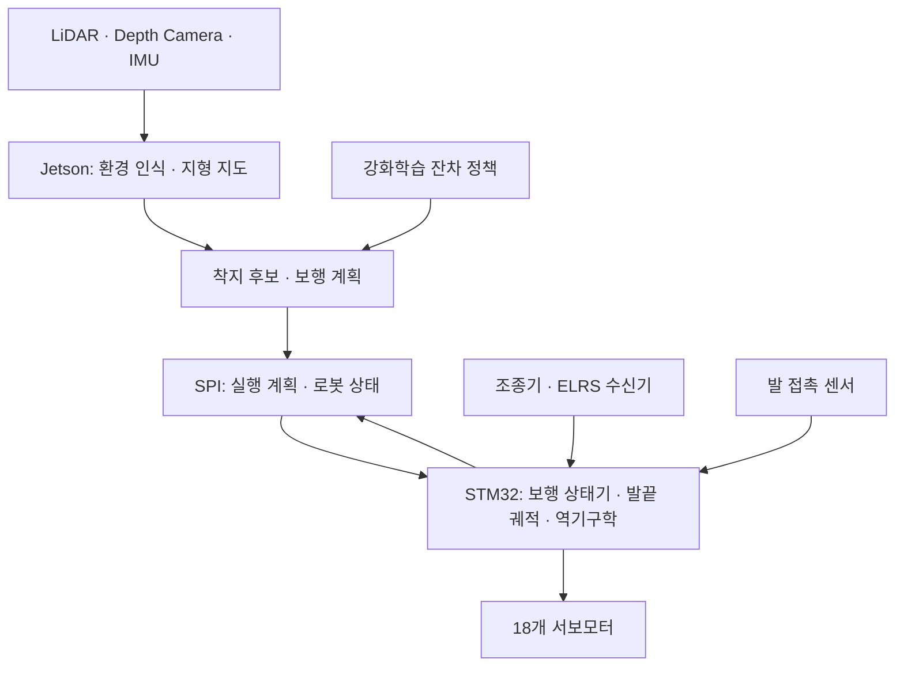

# 모듈형 재난대응 6족 로봇

험지 보행과 환경 인식을 위한 18자유도 로봇 플랫폼

<p align="center">
  
</p>

## 1. 프로젝트 개요

### 1-1. 프로젝트 소개

**모듈형 재난대응 6족 로봇**은 잔해, 경사면, 단차처럼 접근하기 어려운 곳을 탐색하기 위한 보행 로봇이다. 인하대학교 로봇연구회에서 2024년부터 개발해 왔으며, 다리 6개와 관절 18개로 구성된다.

기본 보행은 STM32에서 제어하고, 지형 인식과 보행 계획은 Jetson에서 처리하는 구조다. 공통 몸체에 센서와 작업 장비를 교체해 장착할 수 있도록 설계했다. 현재는 보행 제어와 시뮬레이션을 중심으로 개발하고 있으며, 지도 생성·자율 탐색·현장 작업으로 기능을 확장하는 것이 목표다.

### 1-2. 개발 배경 및 필요성

재난 현장의 무너진 구조물과 불규칙한 지면은 사람의 접근을 어렵게 한다. 바퀴형 로봇도 큰 단차나 잔해 사이에서는 이동 경로가 제한된다. 다리형 로봇은 발을 디딜 위치를 선택할 수 있지만, 지형을 읽고 접촉 상태에 따라 보행을 조정해야 한다.

이 프로젝트에서는 여섯 다리로 지지점을 확보하고, 각 발의 접촉 상태를 이용해 착지를 보정한다. 동시에 센서와 작업 모듈을 바꿔 같은 플랫폼을 여러 탐색 임무에 사용할 수 있도록 구성하고 있다.

### 1-3. 프로젝트 특장점

- **Tripod·Wave 보행:** 세 발씩 움직이는 Tripod와 한 발씩 움직이는 Wave를 상황에 따라 사용한다.
- **발 접촉 기반 착지 보정:** 발의 FSR 센서로 이른 착지와 늦은 착지를 감지해 발끝 궤적을 조정한다.
- **지형 계산과 강화학습의 결합:** 지형 계산으로 가능한 착지점을 정하고, 강화학습은 그 범위 안에서 발 위치·높이·몸체 자세·보폭·타이밍을 조절한다.
- **상위 연산과 실시간 제어 분리:** Jetson이 보행 계획을 만들고 STM32가 200 Hz로 궤적·역기구학·서보 출력을 처리한다.
- **교체 가능한 장착부:** 센서와 적재·작업 장비를 임무에 맞게 추가할 수 있는 기구 구조를 사용한다.

### 1-4. 주요 기능

| 기능 | 내용 | 개발 현황 |
|---|---|---|
| 기본 보행 | 발끝 궤적, 3자유도 역기구학, 18개 서보 제어 | STM32 코드 구현 |
| 접촉 적응 | Early Landing·Late Landing, 지지발 재접촉, 작업영역 제한 | STM32 코드 구현 |
| 수동 조종 | RadioMaster Pocket 입력, 전후진·회전·보행 방식 전환 | 조종기 입력과 제어 코드 구현 |
| 지형 적응 보행 | 착지 후보 계산, 잔차 정책, Tripod·Wave 전환 | MJX 시뮬레이션·학습 코드 구현 |
| 환경 인식·자율 탐색 | LiDAR·Depth Camera·IMU를 이용한 지도 생성과 경로 계획 | 상위 시스템 설계 및 센서 연동 개발 대상 |
| Jetson–STM32 통신 | 보행 실행 계획과 접촉·관절 상태 교환 | SPI 코덱과 STM32 처리 경로 구현, 실물 통신 시험 필요 |
| 임무 모듈 | 매니퓰레이터, 적재함, 열화상·가스 센서 | 확장 설계 대상 |

### 1-5. 기대 효과 및 활용 분야

사람이 진입하기 전 현장의 지형과 장애물을 살펴보고, 필요한 센서나 소형 물품을 운반하는 데 활용하고자 한다. 재난 현장 선행 탐색뿐 아니라 불규칙한 지면의 시설 점검, 다족 보행 제어와 강화학습 연구에도 사용할 수 있다.

### 1-6. 기술 스택

| 구분 | 사용 기술·장비 |
|---|---|
| 상위 컴퓨터 | NVIDIA Jetson Orin Nano Super |
| 실시간 제어 | STM32 NUCLEO-F446RE, C, STM32CubeIDE |
| 제어 설계 | MATLAB, Simulink, 3자유도 역기구학, 보행 상태기 |
| 시뮬레이션·학습 | Python, MuJoCo/MJX, JAX, Brax, PPO |
| 학습 기록 | Weights & Biases |
| 센서 | Livox MID-360, Intel RealSense D435, WT931 IMU, FSR 402 |
| 조종·통신 | RadioMaster Pocket ELRS, CRSF, SPI, UART, LoRa |
| 구동·제작 | DS51150-270 서보모터, Fusion 360, 3D 프린팅, PCB |

---

## 2. 팀원 소개

| 팀원 | 담당 역할 |
|---|---|
| 멘티1 | Simulink를 활용한 보행 제어기 설계 |
| 멘티2 | Isaac Sim을 활용한 보행 강화학습 |
| 멘티3 | Isaac Sim을 활용한 SLAM 및 경로 생성 |
| 멘티4 | Fusion 360을 활용한 3D 설계 |

---

## 3. 시스템 구성도

### 3-1. 하드웨어 구성

<p align="center">
  
</p>

Jetson에는 지형 인식용 센서를 연결하고, STM32에는 발 접촉 센서와 관절 구동부를 연결한다. 조종기 명령은 ELRS 수신기의 CRSF 데이터로 전달한다.

### 3-2. 소프트웨어 흐름



환경 인식과 자율 탐색은 센서 연동을 포함한 개발 목표다. 현재 Jetson 코드는 외부에서 전달받은 점군과 상태 추정값으로 실행 계획을 계산하는 경로를 제공하며, 실제 센서 수집·시간 동기화·SPI Master 운용은 추가 연결이 필요하다.

### 3-3. 보행 제어

기본 보행은 3차 Smoothstep으로 수평 이동을 보간하고, 포물선으로 발의 들림 높이를 만든다. 지형 적응 모드에서는 5차 보간 궤적으로 발의 최고점과 수평 이동 타이밍을 조절한다. 계산한 발끝 좌표는 각 다리의 역기구학을 거쳐 관절 목표각으로 변환된다.

예상보다 빨리 접촉한 발은 착지를 마치고 지지 상태로 전환한다. 예정 시점에 접촉하지 못한 발은 정해진 한도 안에서 아래로 내려 지면을 찾는다. 관절 한계와 작업영역을 벗어나는 명령은 제한한다.

지형 적응 정책의 출력은 24차원이다. 발 6개의 수평 착지 위치와 여유 높이, 몸체 Roll·Pitch·높이, 보폭, 발 이동 타이밍을 조절한다. 지형 높이는 기하 계산으로 정하고, 정책이 요청한 착지점은 실행 가능한 후보로 제한한다. 현재 학습 관측은 24×24×6 지역 높이 지도를 읽는 CNN 구조를 사용한다.

Jetson–STM32 지형 적응 경로는 128바이트 SPI 프레임을 사용한다. 이전 센서·GPS용 64바이트 규격과 프레임 크기가 다르므로 양쪽 구현을 맞춰야 한다. 자세한 필드와 단위는 [SPI 명세](docs/ADAPTIVE_SPI_V3.md)에 정리했다.

### 3-4. 기록된 제어 실험

아래 값은 2026-08-31 MATLAB/Simulink에서 실행한 `plant.slx`의 관절·기구학 제어 시험 결과다. 몸체를 월드에 고정한 모델이므로 자유 보행이나 험지 통과 성능을 나타내지는 않는다.

| 평가 항목 | 결과 |
|---|---:|
| 6개 다리 발끝 통합 RMS 거리 오차 | 3.385 mm |
| 발끝 최대 거리 오차 | 8.631 mm |
| 18개 관절 통합 RMS 오차 | 0.4004° |
| 역기구학 유효 표본 비율 | 100% |

<p align="center">
  
</p>

시험 조건과 원시 데이터는 [Simulink 실험 결과](SW/Controller/Simulink/evaluation/RESULTS.md)를 참고한다. 실제 보행 속도, 계단 통과율, 지형별 성공률과 강화학습 적용 전후 성능은 추가 실물 시험이 필요하다.

---

## 4. 작품 소개영상

[](https://youtu.be/klPdgZPBS-Q)

---

## 5. 핵심 소스코드

### 5-1. 발끝 궤적 생성

[`swing_trajectory.c`](SW/STM32/workspace/Hexapod/Core/Src/high_control/swing_trajectory.c)의 기본 보행 계산 부분이다. 진행률을 0~1로 제한한 뒤, 수평 이동과 발의 높이를 계산한다.

```c
limited = fminf(fmaxf(progress, 0.0f), 1.0f);
scaled = limited * limited * (3.0f - 2.0f * limited);
height_curve = 4.0f * height_m * scaled * (1.0f - scaled);

output.x = start->x + (end->x - start->x) * scaled;
output.y = start->y + (end->y - start->y) * scaled;
output.z = start->z + (end->z - start->z) * scaled + height_curve;

radial_bulge = radial_offset_m * 4.0f * scaled * (1.0f - scaled);
output.x += radial_bulge * cosf(leg_angle_rad);
output.y += radial_bulge * sinf(leg_angle_rad);
```

### 5-2. 3자유도 역기구학

[`leg_kinematics.c`](SW/STM32/workspace/Hexapod/Core/Src/high_control/leg_kinematics.c)에서 발끝 목표를 Coxa·Femur·Tibia 관절각으로 바꾼다. 도달할 수 없는 좌표는 거부하고, 계산된 각도의 유효성과 관절 한계를 함께 검사한다.

```c
cosine_knee = fminf(fmaxf(cosine_knee, -1.0f), 1.0f);
sine_knee = sqrtf(fmaxf(0.0f, 1.0f - cosine_knee * cosine_knee));
angle_rad[0] = atan2f(local->y, local->x);
angle_rad[2] = atan2f(sine_knee, cosine_knee);
angle_rad[1] = atan2f(-local->z, planar) -
               atan2f(ROBOT_LINK_3_M * sine_knee,
                      ROBOT_LINK_2_M + ROBOT_LINK_3_M * cosine_knee);
```

### 5-3. 주요 모듈

| 소스 | 역할 |
|---|---|
| [gait_manager.c](SW/STM32/workspace/Hexapod/Core/Src/high_control/gait_manager.c) | Tripod·Wave 보행 순서와 위상 전환 |
| [contact_adaptation.c](SW/STM32/workspace/Hexapod/Core/Src/high_control/contact_adaptation.c) | 발 접촉에 따른 착지 보정 |
| [rl_controller.c](SW/STM32/workspace/Hexapod/Core/Src/high_control/rl_controller.c) | 실행 계획 수신과 유효성·시간 제한 처리 |
| [adaptive_spi_protocol.c](SW/STM32/workspace/Hexapod/Core/Src/communication/adaptive_spi_protocol.c) | 실행 계획·관측 SPI 인코딩과 CRC |
| [adaptive_runtime.py](SW/Jetson/adaptive_runtime.py) | 점군·상태 추정값으로 보행 실행 계획 계산 |
| [adaptive_foothold_estimator.py](mjx/adaptive_foothold_estimator.py) | 지형과 다리 작업영역에 따른 착지 후보 계산 |
| [hybrid_gait_supervisor.py](mjx/hybrid_gait_supervisor.py) | Tripod·짧은 보폭·Wave·정지 전환 판단 |
| [adaptive_grid_network.py](mjx/adaptive_grid_network.py) | 지역 높이 지도를 읽는 정책 네트워크 |

---

## 저장소 구성 및 개발 문서

```text
Hexapod-Robot/
├── HW/                 # 기구, PCB, 부품 목록, URDF
├── SW/
│   ├── Arduino/        # 매니퓰레이터 제어
│   ├── Controller/     # 제어 설계, 좌표계, Simulink
│   ├── Jetson/         # 상위 보행 계획과 통신
│   └── STM32/          # 실시간 보행 제어 펌웨어
├── mjx/                # MuJoCo/MJX 시뮬레이션과 학습
├── scripts/            # 뷰어, 학습, 빌드 실행 스크립트
└── docs/               # 사용법, 설계 문서, 보고서
```

- [개발 문서 안내](docs/README.md)
- [하드웨어 구성](HW/README.md) · [부품 목록](HW/parts.md)
- [제어기 구성](SW/Controller/Controller_Architecture.md) · [제어기 상세 설계](SW/Controller/Controller_detail.md)
- [STM32 코드 구조](SW/STM32/STM32%20코드%20구조%20정리본.md)
- [2026 인하 종합설계경진대회 최종보고서](docs/2026-inha-capstone-final-report-public.pdf)
